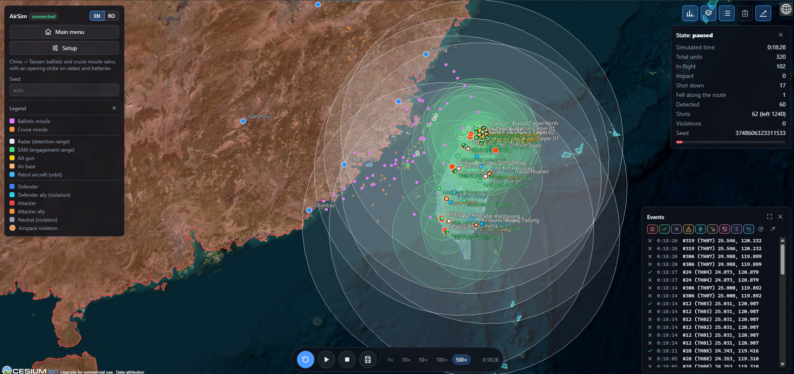
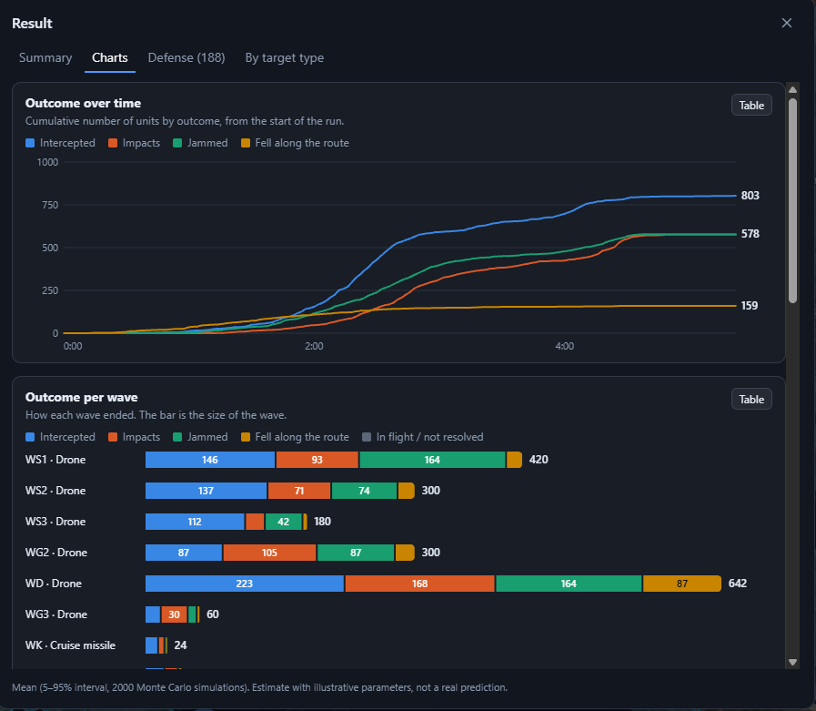
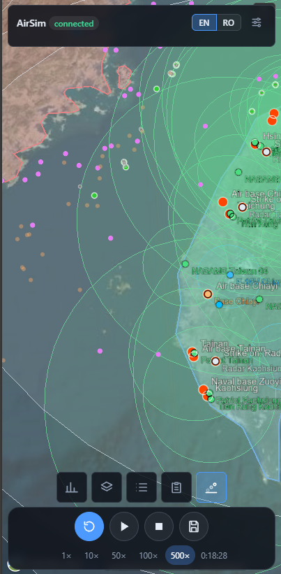
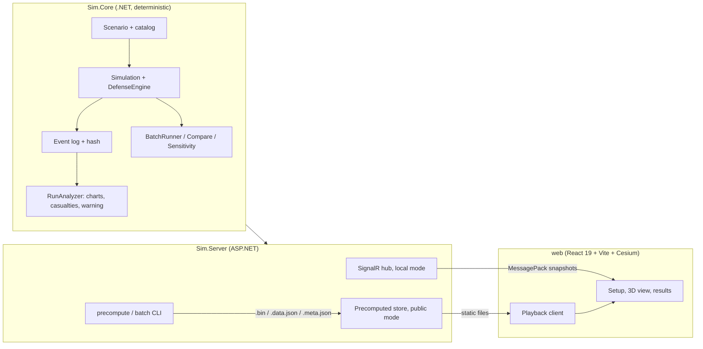

# AirSim: air attack and air defense simulator


A deterministic simulator of drone, cruise-missile and ballistic-missile attacks against layered air defenses, with a 3D globe, a time-of-day and weather model, and a statistical after-action report.

The scenarios are loosely based on public reporting on recent conflicts. **All parameters are illustrative, not calibrated against real events** (see [Assumptions and limits](#assumptions-and-limits)). This is a portfolio project: the point is the engineering (determinism, an analysis pipeline, a precomputed public mode), not a prediction of any real outcome.

**[Live demo](https://airsim.rusin.ro)** (precomputed runs of 18 scenarios, day and night variants, with the full after-action report). For the complete feature set (live simulation, your own scenarios, A/B comparison, batch runs) [run it locally](#quick-start); see [the comparison below](#live-demo-vs-running-it-locally).



<p align="center">
  
  &nbsp;
  
</p>

*Top: the China to Taiwan scenario, paused 18 minutes in (102 missiles in flight, 17 shot down). Bottom left: the after-action Charts tab of a large drone raid. Bottom right: the phone layout.*

## Contents

- [What it does](#what-it-does)
- [Live demo vs running it locally](#live-demo-vs-running-it-locally)
- [How the model works](#how-the-model-works)
- [Scenarios](#scenarios)
- [Determinism](#determinism)
- [Architecture](#architecture)
- [Quick start](#quick-start)
- [Using the app](#using-the-app)
- [Public mode and deployment](#public-mode-and-deployment)
- [HTTP API](#http-api)
- [Assumptions and limits](#assumptions-and-limits)
- [Project layout](#project-layout)

## What it does

**Attack side**
- Waves of drones, cruise missiles, ballistic missiles and aircraft, each with its own speed, altitude, warhead, cost, failure rate and jamming resistance (39 offensive unit types in the catalog).
- Decoys, in-flight retargeting, several launch sites and several targets per wave.
- Counterplay: an attacker can strike radars, batteries and airbases before the main wave, and an impact can destroy the system it hits.

**Defense side**
- Radars limited by the radar horizon, SAMs, anti-aircraft guns, anti-ballistic systems, fighter patrols that rearm at airbases, interceptor-drone bases and electronic warfare with jamming saturation (35 defensive unit types).
- Optional radar network: a battery can only fire at what the network, or its own radar, tracks.
- Doctrine: threat priority, ammunition reserve, shoot-look-shoot, cost-ratio limits and deliberate "leakers".

**Environment**
- Time of day from the real sun position, with illustrative effects on optics and on the number of people exposed.
- Weather presets: clear, overcast, rain, fog, storm.
- Hit probability that depends on the target's altitude, per defense type.
- Airspace: countries have roles (defender, attacker, ally, neutral), and flying through a neutral country's airspace is logged as a violation. 237 countries and seven alliances (NATO, EU, CSTO, Union State, Five Eyes, AUKUS, Quad) can be assigned in bulk.

**After-action report**
- Outcomes over time and per wave, ammunition spent, and the cost of both sides.
- A casualty estimate with uncertainty (Monte Carlo over the model's inputs).
- A public-warning model: how long before impact each threat was first detected, and what share of the exposed people it let reach shelter.
- A one-at-a-time sensitivity analysis ("what moves the result").

**Tools**
- Batch runs with the distribution of every metric, paired A/B comparison of two scenarios, parameter sweeps, and saved runs that replay exactly.
- English and Romanian UI, and a layout that works on a phone.

## How the model works

The core is a fixed-step simulation (0.1 s by default). Drones are processed in id order, so the event order is deterministic. The defense engine runs a decision cycle (1 s by default) on top of that.

**Detection.** A radar sees a target if it is inside its range *and* above the radar horizon, which depends on the heights of both the radar and the target (`4.12 km x (sqrt(h_radar) + sqrt(h_target))`, with heights in metres). There is no terrain masking. In networked scenarios a battery can also use tracks shared by other radars within link range.

**Engagement.** Each defensive unit engages at most one target per cycle, if the target is inside its engagement range and the unit has ammunition. The probability of a hit starts from the catalog value of that system against that kind of threat and is then scaled by:

| Factor | Effect |
|---|---|
| Weather preset | scales range and hit probability per defense type (fog hurts optical guns and short-range systems, storm hurts almost everything a little) |
| Altitude curve | each type has a table of `(altitude, factor)` points, interpolated linearly: guns are best below about 1 km, long-range SAMs struggle against targets near the ground |
| Time of day | optically guided systems lose effectiveness at night; radar-guided ones do not |
| Electronic warfare | jamming has a falloff with distance and saturates when it has to deal with too many targets at once |

**Doctrine.** The defender decides what to shoot at first (threat priority), how much ammunition to keep in reserve, whether to fire a second shot only after observing the first, and when a target is too cheap to be worth an expensive interceptor (cost-ratio limit). Targets that fall below the limit become deliberate leakers.

**Drones can fail on their own.** Every wave has a failure rate (mechanical failure, navigation loss). Rain and fog raise it a little and storms a lot, for drones only.

**Casualties.** For each impact the model takes a lethal radius from the warhead mass and an exposed population by terrain class (city, military base, open field), applies fractions killed and injured, and propagates the uncertainty of all of these with a Monte Carlo run (2000 samples). The estimate is reported as a mean with a 5 to 95 percent interval.

**Public warning.** The time between the first detection of a threat and its impact is the warning time. After a fixed alert delay (30 s), a growing share of the people exposed to that impact reach shelter, which reduces only the fatal fraction. At night the time needed to reach shelter is longer, because people are asleep. Coverage depends on the terrain class (cities 0.6, military bases 0.9, open fields none). The warning can be turned off in the setup screen to see how much of the result it explains.

**Sensitivity.** The "what moves the result" chart scales one input at a time (hit probability, range, radar range, magazine size, reload time, jamming, number of attackers, speed, failure rate) by 0.8 and 1.2, with paired seeds, and shows the change in impacts, casualties and interceptions. A Z score above 2 means the effect is real and not noise; the bars of non-significant effects are drawn faded.

## Scenarios

18 scenarios are shipped in `scenarios/`, and each has a day and a night variant in the public build. The first twelve are loosely based on public reporting on recent conflicts; the last six are small examples that exercise one feature each.

| Scenario | What it models |
|---|---|
| `ru-vs-ua` | Russia to Ukraine: a massive raid (about 2000 drones plus missiles) from several directions on Kyiv and other cities |
| `ua-vs-ru` | Ukraine to Russia: a raid of about 2000 long-range drones toward the Saint Petersburg region, violating Belarusian airspace |
| `ir-vs-il` | Iran to Israel, without proxies: a coordinated salvo of drones, cruise and ballistic missiles |
| `ir-vs-il-proxies` | The same salvo coordinated with Hezbollah, Gaza, the Houthis and militias in Iraq (12 waves) |
| `il-vs-ir` | Israel to Iran: a strike on air defenses and on nuclear and missile objectives |
| `cn-vs-tw` | China to Taiwan: a ballistic and cruise missile salvo with an opening strike on radars and batteries |
| `kp-vs-kr` / `kr-vs-kp` | North Korea to South Korea (Seoul area) and the retaliatory strike on Pyongyang |
| `in-vs-pk` / `pk-vs-in` | India to Pakistan, and Pakistan to India: strikes on air bases, air defenses and cities |
| `ru-vs-baltic` | Russia to NATO East (the Baltics and Poland): strikes on air defenses, bases and logistics hubs |
| `ru-vs-natose` | Russia to NATO South-East (Black Sea): Romania, Bulgaria, Greece and Turkey |
| `example-*` | `basic`, `defense`, `full`, `catalog`, `airspace` and `counter`: small scenarios for learning the tool and for the tests |

The scenario files are plain JSON, and `tools/` has the Python scripts that generated the larger ones. You can also build a scenario from scratch in the setup screen (local mode only).

## Determinism

Everything the simulation does comes from the scenario and a seed: the same inputs give the same event log, bit for bit, on any machine and with any number of threads.

- A run is identified by **scenario hash + seed + engine version**. The scenario is hashed in a canonical form (fixed property order, ordinal sorting), and new optional fields are left out of that form when unset, so older scenarios keep their hash.
- Randomness comes from a seeded generator with one derived stream per entity, so adding a unit does not shift the random numbers of the others.
- The precompute tool runs every scenario twice and refuses to write a result if the event-log hashes differ.
- The analysis (casualties, charts, sensitivity) is a pure function of scenario, events and seed.
- `EngineInfo.Version` must change whenever logic that affects results changes. The public server ignores precomputed runs from another engine version.

## Architecture



- **`src/Sim.Core`**: the model, with no dependency on the web. Geodesy, airspace and country rasters, the unit catalog, the simulation loop, the defense engine, day/night and weather, and the analyzers.
- **`src/Sim.Server`**: the local server (live simulation over SignalR with MessagePack snapshots) and the **public mode**, which has no live simulation, no custom scenarios and no disk writes, and serves precomputed runs as static files with a per-IP rate limit.
- **`web`**: the frontend. In public mode a playback client composes snapshots from the stored frames, so the map and the panels do not know there is no live simulation.
- **`data/catalog`**: the offensive and defensive unit types, each with a `source` and `notes` field saying where the numbers come from.

**Charts** are plain SVG (no charting library), each with a table view, a legend, a hover tooltip and light and dark themes.

## Live demo vs running it locally

The hosted demo is a **public mode** on purpose: it has no live simulation and no user-supplied input, so there is nothing on the server for a visitor to abuse. It plays back runs that were computed in advance, so the result is identical every time. The full application is the one you run yourself.

| | Live demo (public mode) | Local (full) |
|---|---|---|
| Shipped scenarios | all 18, each with a day and a night run | all 18 |
| Playback | pause, speed from 1x to 500x, seek | pause, speed from 1x to 500x |
| 3D globe, coverage rings, event log | yes | yes |
| After-action charts, casualty estimate, public warning, sensitivity | yes, precomputed (seed 1) | yes, computed for each run |
| Build your own scenario in the editor | no | yes |
| Choose seed, time of day, weather, public warning | no | yes |
| Live simulation | no, stored frames | yes, streamed over SignalR |
| A/B comparison, batch runs, sweeps | no | yes (UI and CLI) |
| Saved runs with exact replay | no | yes |

Frames in the demo are stored at a fixed step (1 to 30 s, chosen to fit a size budget), so on very large scenarios trajectories are interpolated between frames. Locally the simulation runs at its own step of 0.1 s.

## Quick start

Requirements: .NET 10 SDK and Node 22. This starts the full local application, with every feature listed above.

```bash
# backend (local mode, live simulation) on http://localhost:5080
dotnet run -c Release --project src/Sim.Server

# frontend on http://localhost:5173 (proxies /api and /hubs to the backend)
cd web && npm install && npm run dev
```

Use `-c Release`: the simulation is about 6 times faster than in Debug.

### Tests

```bash
dotnet test
```

The suite has 288 xUnit tests: determinism and replay, the random generator, geodesy, airspace, the catalog, defense and doctrine, electronic warfare, counterplay, multi-target waves, day/night, weather and altitude, batch and A/B comparison, sensitivity and the casualty and warning models.

### Command line

```bash
# N runs of a scenario in parallel, distribution of each metric
dotnet run -c Release --project src/Sim.Server -- batch scenario=ru-vs-ua runs=30 [seed=1] [threads=8] [out=dir]

# one-at-a-time sensitivity (each input scaled by 0.8 and 1.2), or a jamming sweep
... -- batch scenario=ru-vs-ua runs=20 sens=0.2
... -- batch scenario=ru-vs-ua runs=30 jam=0.5,1,1.5

# precomputed runs for the public mode (day and night variants of every scenario)
... -- precompute [scenario=all|id] [seed=1] [maxmb=30] [out=dir] [variants=day,night|none] [sens=16] [threads=8] [resume=on]
```

`precompute` runs every scenario at midday and at night, writes `<id>.day.*` and `<id>.night.*`, and embeds the sensitivity analysis in each result. The sensitivity costs `(1 + 2 x factors) x sens` extra simulations per run, so for very large scenarios use a smaller `sens=`. `resume=on` skips the runs that are already complete, and `threads=N` generates several variants at once.

## Using the app

- **Home and gallery:** pick one of the shipped scenarios, or in local mode build your own.
- **Setup (local mode):** place defense systems and attack waves on the map from the catalog, assign countries to sides (one by one or by alliance), and set the time of day, the weather, the public warning and the seed.
- **Run:** the 3D globe shows every unit and the coverage rings of radars and SAMs. Playback runs from 1x to 500x, and the dock has toggles for altitude fading (drones get more transparent the closer they fly to the ground). The event log can be filtered by type and searched.
- **Result:** the summary, per-defense and per-target-type tables, and the **Charts** tab with outcome over time, outcome per wave, ammunition, cost, the casualty distribution, the public-warning tiles and the sensitivity ("tornado") chart.
- **Compare and saved runs (local mode):** a paired A/B comparison of two scenarios over many seeds, and a library of saved runs that replay exactly.

## Public mode and deployment

This is how the live demo is hosted. The public build serves the 18 scenarios, each with a day and a night run, as precomputed playback. There is no live simulation and no user-supplied scenario, so there is no server-side compute to abuse.

```bash
Sim__Mode=public   # no simulation routes, no hub, read-only API, rate limit 300 requests/min per IP
```

The precomputed runs are build artifacts (hundreds of MB) and are **not committed to git**. Generate them with `precompute`, then either mount the folder into the container or bake them into an image:

```bash
# 1. generate the runs
dotnet run -c Release --project src/Sim.Server -- precompute

# 2a. default image: runs mounted from ./precomputed (see docker-compose.yml)
docker compose up --build -d

# 2b. standalone image that generates the runs while building (slow with the default sens=16, so pass a smaller one)
docker build --target standalone --build-arg PRECOMPUTE_ARGS="sens=4" -t airsim .
```

The compose file runs the container read-only, drops all capabilities and limits memory to 512 MB. Put a reverse proxy in front (nginx, Caddy, Traefik) for TLS. It **must send `X-Forwarded-For`**, because the rate limit reads the client address from it.

If you regenerate runs after changing the engine, delete the old files first: the server skips and warns about every run whose engine version, scenario hash or seed does not match.

## HTTP API

Both modes (read-only):

| Endpoint | Purpose |
|---|---|
| `GET /api/mode` | `public` or `local` |
| `GET /api/scenarios`, `GET /api/scenarios/{id}` | the shipped scenarios |
| `GET /api/catalog` | unit types with their source and notes |
| `GET /api/alliances`, `GET /api/airspace/{map}` | country groups and the airspace rasters |
| `GET /api/precomputed`, `/api/precomputed/{id}/data`, `/api/precomputed/{id}/bin` | the stored runs (`?v=day\|night`) |

Local mode only: `POST /api/sim/start`, `/sim/start-custom`, `/sim/pause`, `/sim/resume`, `/sim/stop`, `/sim/speed`, `/sim/save`, `GET /api/sim/status`, `/sim/summary`, `/sim/replay-check`, `GET /api/runs`, `POST /api/runs/{id}/replay`, `POST /api/compare` and `GET /api/compare/{id}`. The live stream is a SignalR hub at `/hubs/sim`.

## Assumptions and limits

Read this before drawing any conclusion from a result.

- **The numbers are illustrative.** Ranges, probabilities of hit, magazine sizes, costs and failure rates come from public sources where available, and are estimates otherwise (each catalog entry says which). Nothing was calibrated or validated against real events, because comparable data are not public. The simulator is good for comparing configurations against each other and for seeing which inputs matter, not for predicting outcomes.
- **Day, night, weather, altitude and public warning are modeled with simple multiplicative factors.** The direction of each effect is reasoned (optics suffer at night and in fog, radars lose a little in rain, long-range SAMs struggle against very low targets, people who have time to reach shelter are less likely to die); the sizes are not measured.
- **The world is flat apart from the radar horizon.** There is no terrain model and no terrain masking: a radar sees a low target as far as the Earth's curvature allows, regardless of hills.
- **Weather is a static preset** for the whole run, with no forecast and no change over time.
- **The casualty model is deliberately simple:** a lethal radius from the warhead mass, an exposed population by terrain class and fractions killed and injured. It is not a damage assessment.
- **No automatic radar destruction.** An impact destroys the system it hits, but the simulator does not guess where hidden radars are, so it does not destroy them as a side effect of an attack.
- **Each defensive unit engages at most one target per cycle**, and there is no command-and-control delay.
- **Precomputed playback** stores frames at a fixed step (1 to 30 s, chosen to fit a size budget), so on large scenarios trajectories are interpolated between frames.

## Project layout

```
src/Sim.Core          deterministic model and analyzers
src/Sim.Server        ASP.NET server, SignalR hub, CLI (batch, precompute)
tests/Sim.Core.Tests  xUnit tests
web                   React 19 + Vite + CesiumJS frontend (i18n: en, ro)
data                  unit catalog, country maps, alliances
scenarios             shipped scenarios (JSON)
tools                 scenario generators (Python)
docs/img              screenshots used in this README
```
